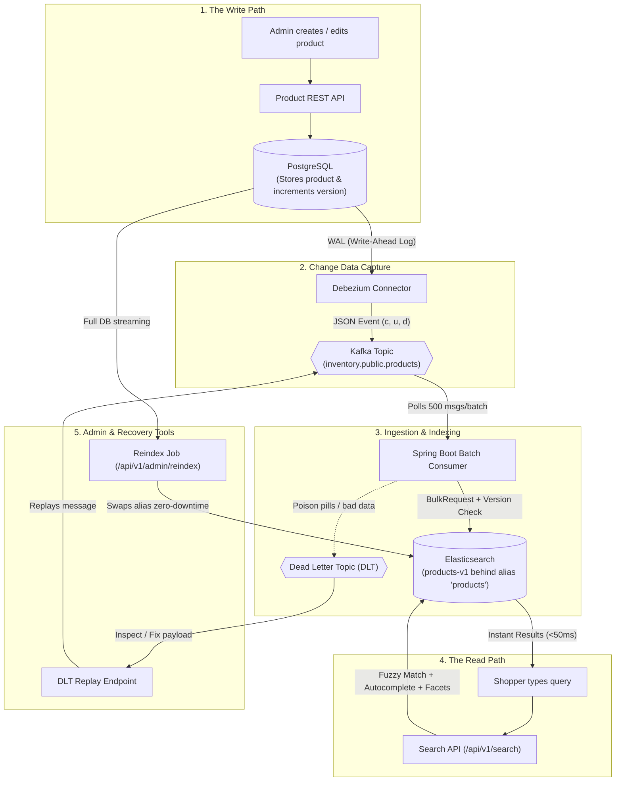

# Project Flow Explained in Simple Words

## 🌟 The 1-Minute Big Picture

Imagine you are running an online store (like Amazon):
- **PostgreSQL** is your **accountant's ledger**: It is rock-solid, reliable, and keeps track of real inventory, prices, and orders. But it is slow at complex text searching.
- **Elasticsearch** is your **store catalog & search engine**: It is super fast at fuzzy typo search (`iphne` -> `iPhone 15`) and autocomplete, but it is not safe as your primary bank-grade database.

### The Problem: Why Not Just Write to Both at Once? (The "Dual-Write Trap")
If your backend tries to save a product into PostgreSQL **and then** save it into Elasticsearch:
1. What if Elasticsearch crashes halfway through? Your database has the item, but search doesn't.
2. What if two people update the same product at the same time? Updates can reach Elasticsearch in reverse order, overwriting newer data with older data.

### The Solution: Change Data Capture (CDC)
We write **ONLY to PostgreSQL**. A background listener (Debezium) reads PostgreSQL's internal journal (WAL) and streams every change through **Apache Kafka** into **Elasticsearch**.

```
[Store Admin / API]
       │
       ▼ (1. Writes)
[ PostgreSQL Database ]  <-- Single source of truth!
       │
       ▼ (2. Reads database transaction log)
 [ Debezium / Kafka Connect ]
       │
       ▼ (3. Publishes event)
   [ Apache Kafka ]
       │
       ▼ (4. Consumes in batches)
[ Spring Boot Consumer ]
       │
       ▼ (5. Bulk indexes with version check)
  [ Elasticsearch ]  <-- Fast search engine
       ▲
       │ (6. Lightning-fast search queries)
[ Shopper Searching Products ]
```

---

## 🔄 Step-by-Step Flow



---

## 🔍 Detailed Walkthrough of Each Step

### Step 1: The Product Is Saved to the Database
1. A seller calls `POST /api/v1/products` or `PATCH /api/v1/products/{id}`.
2. The application checks validity (positive price, valid title, etc.).
3. The data is saved into **PostgreSQL**.
4. PostgreSQL increments the row's `version` number (e.g., version goes from `0` -> `1`).
5. PostgreSQL writes this transaction into its **WAL (Write-Ahead Log)**.
6. The seller gets an immediate `200 OK` or `201 Created` response.

---

### Step 2: Debezium Catches the Change
1. **Debezium** sits right next to PostgreSQL like a security camera watching the WAL log.
2. The instant the transaction commits, Debezium extracts the row change and creates a message:
   - Operation type: `"c"` (Created), `"u"` (Updated), or `"d"` (Deleted).
   - Payload: The new values (`after`), old values (`before`), and commit timestamp (`source.ts_ms`).
3. Debezium sends this message to the **Kafka** topic: `inventory.public.products`.
4. The message key is the **Product ID**, ensuring all updates for the same product stay in the exact same partition in chronological order.

---

### Step 3: Spring Boot Consumer Batches into Elasticsearch
1. Instead of handling 1 message at a time, the **Spring Boot Consumer** waits and pulls a batch of up to 500 records at once.
2. It packs them into a single **Bulk Request** (`client.bulk()`) and sends them to Elasticsearch in one network trip.
3. **Safety Check (Optimistic Versioning):**
   - Elasticsearch stores the document version as `version + 1`.
   - If an old update arrives late due to network delays, Elasticsearch rejects it (`409 Conflict`), preventing stale data from overwriting newer data.
4. **End-to-End Lag Metric:**
   - The consumer calculates how many milliseconds passed between PostgreSQL committing the change and Elasticsearch indexing it, recording the metric in **Micrometer** (`products.cdc.lag`).

---

### Step 4: The Shopper Searches
1. A user searches `iphne` with price between \$500 and \$1000.
2. The **Search API** hits Elasticsearch's alias `products`:
   - **Typo Tolerance:** Finds `"iPhone 15"` even with typos (`iphne`).
   - **Autocomplete:** Suggests products after typing just 2–3 letters (`iph` -> `iPhone`).
   - **Facets / Aggregations:** Returns available categories and price ranges (min, max, average).
   - **Availability:** Correctly filters out inactive or out-of-stock items (`stockQuantity <= 0`).
3. The search response returns in under 30–50 ms.

---

## 🛡️ "What If Something Breaks?" (Failure Handling)

| Scenario | What Happens? | How the System Recovers |
| :--- | :--- | :--- |
| **A message has corrupted JSON or missing fields** | The consumer recognizes this as a "poison pill". | It does not retry infinitely. It routes the message straight to the **Dead Letter Topic (DLT)** so other valid messages keep flowing. |
| **We want to fix and re-run a poisoned message** | Admin calls `GET /api/v1/admin/dlt` to view the error. | Admin calls `POST /api/v1/admin/dlt/replay` with the corrected JSON to inject it back into the main topic. |
| **Kafka Connect disconnects or crashes** | PostgreSQL's WAL log would usually keep growing and fill up the entire hard disk. | `max_slot_wal_keep_size=1024MB` caps the replication slot at 1GB to prevent server crashes. |
| **We need to change the search mapping (e.g. add new fields)** | Changing an active index causes downtime. | We create index `products-v2`, run `POST /api/v1/admin/reindex` to stream all rows from Postgres to ES, and atomically swap the alias `products` with **zero downtime**. |

---

## ⚖️ Who Does What?

| Responsibility | PostgreSQL | Elasticsearch |
| :--- | :---: | :---: |
| **Role** | System of Record (Truth) | Search Projection (Read Model) |
| **Guarantees** | ACID Transactions, Strict Integrity | Sub-50ms Fuzzy Search & Analytics |
| **Receives Direct API Writes?** | ✅ Yes | ❌ No (Fed by Kafka CDC) |
| **Handles Complex Text Search?** | ❌ Slow / Complex | ✅ Lightning Fast (BM25 + N-Grams) |
| **Handles Hard Deletes?** | ✅ Authoritative Delete | ✅ Idempotent Document Removal |
